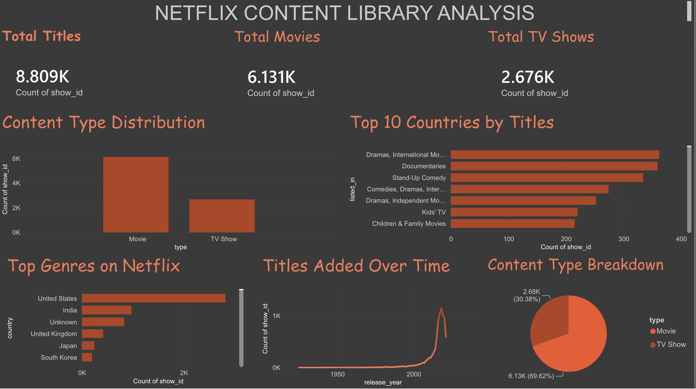

# Netflix Content Library Analysis

A full-stack data analysis project covering the complete pipeline from raw data to an interactive dashboard — **Excel → SQL → Python → Power BI**.




---

## Project Overview

This project analyzes the public [Netflix Movies and TV Shows dataset](https://www.kaggle.com/datasets/shivamb/netflix-shows) (8,807 titles) to uncover patterns in content type, geographic origin, genre distribution, and catalog growth over time.

What makes this project worth a closer look isn't just the final charts — it's the realistic, messy path to get there, including a genuine data-corruption bug that was found and fixed mid-project (see below).

**Tools used:** Excel, SQL (SQLite), Python (pandas, matplotlib, seaborn), Power BI

---

## Pipeline

| Stage | Tool | What happened |
|---|---|---|
| 1. Data cleaning | Excel | Diagnosed and filled missing values across `director`, `cast`, `country` |
| 2. Database & analysis | SQL (SQLite) | Loaded cleaned data, wrote aggregate queries, found & fixed a real data bug |
| 3. Verification & visualization | Python | Independently re-verified the cleaned data, built exploratory charts |
| 4. Dashboard | Power BI | Built an interactive report with KPI cards and 5 visuals |

---

## Key Insights

- **Content mix:** ~70% Movies, ~30% TV Shows (6,131 vs 2,672 titles)
- **Geographic origin:** The United States (2,818 titles) and India (972 titles) dominate content origin; 831 titles have no listed country
- **Top genres:** Dramas/International Movies, Documentaries, and Stand-Up Comedy lead the catalog
- **Catalog growth:** Titles added grew steadily from 2007 (88 titles) to a peak around 2018 (1,147 titles), then declined slightly through 2021

---

## The Bug: How 90% of a Column Got Silently Corrupted

This is the part of the project I'm most proud of, because it's the kind of problem that shows up in real data work and doesn't get taught in tutorials.

**What happened:** While cleaning the `country` column in Excel using a helper-column formula (`=IF(F2="","Unknown",F2)`), a copy-paste/reference error caused the formula to accidentally point at the `cast` column instead. The result: for the vast majority of rows, `country` silently filled with actor/cast names instead of real countries — with no error, no warning, just wrong data that *looked* complete.

**How it was caught:** After exporting to SQL and running a simple `GROUP BY country` query expecting to see the USA and India at the top, the results instead showed people's names — "David Attenborough," "Jeff Dunham," "Kevin Hart" — as the top "countries."

```sql
SELECT show_id, type, title, director, "cast", country
FROM netflix_titles_cleaned
WHERE country = 'David Attenborough';
```

This confirmed `country` and `cast` held identical values for these rows. Scaling the check up:

```sql
SELECT COUNT(*) FROM netflix_titles_cleaned WHERE country = "cast";
-- 7,982 rows affected — 90% of the entire dataset
```

**How it was fixed:** Rather than redo the Excel work, the original raw CSV was imported as a second table and used as the source of truth, matched by the unique `show_id`:

```sql
UPDATE netflix_titles_cleaned
SET country = (
    SELECT CASE
        WHEN raw.country IS NULL OR raw.country = '' THEN 'Unknown'
        ELSE raw.country
    END
    FROM netflix_titles_raw raw
    WHERE raw.show_id = netflix_titles_cleaned.show_id
);
```

Verified with a re-run of the same check (result: `0`), and a final `GROUP BY country` that now correctly showed United States, India, United Kingdom, Japan, South Korea, etc. — matching the well-known real-world distribution for this dataset.

**Takeaway:** trust but verify. A column can look 100% complete (no blanks, no errors) and still be entirely wrong. Cross-checking results against expected real-world patterns is what caught this.

---

## SQL Concepts Used

- `SELECT`, `WHERE`, `GROUP BY`, `ORDER BY`, `LIMIT`
- Aggregate functions (`COUNT(*)`)
- `UPDATE` with a correlated subquery
- `CASE WHEN` inside a subquery
- Reserved keyword quoting (`"cast"` — a reserved SQL keyword when used as a column name)
- `DELETE` with a `WHERE` clause
- `PRAGMA table_info()` for schema inspection

## Python Concepts Used

- pandas: `read_csv`, `drop`, `value_counts`, `str.split()` + `explode()` for multi-value genre parsing
- matplotlib / seaborn: `countplot`, `barplot`, bar charts, theming and color customization

## Power BI Features Used

- CSV import via Power Query, with column type detection
- KPI Card visuals (Total Titles, Total Movies, Total TV Shows)
- Bar, column, line, and pie charts
- Custom color theming, chart titles, and dashboard layout
- Data source replacement (swapped an intermediate CSV for a freshly re-verified export mid-project)

---

## Known Limitation

The dashboard's Total Titles count (**8,809**) differs slightly from the verified database count (**8,807**) due to minor artifacts introduced during CSV export/import between tools. This 0.02% discrepancy does not affect any of the analysis conclusions above — it's flagged here rather than hidden, as an honest note on data lineage across a multi-tool pipeline.

---

## Files in This Repository

```
netflix-analysis-project/
├── README.md                       (this file)
├── excel/
│   └── netflix_titles_cleaned.csv  (Excel-cleaned data)
├── sql/
│   ├── netflix.db                  (SQLite database)
│   └── queries.sql                 (all SQL queries used)
├── python/
│   └── netflix_analysis.ipynb      (Colab notebook)
└── powerbi/
    └── dashboard_screenshot.png    (final dashboard)
```

---

## What's Next

A planned second, more advanced project will build in from the start:
- Multiple related tables with real SQL `JOIN`s (rather than one flat file)
- DAX measures and time-intelligence functions in Power BI
- A live database connection to Power BI (rather than a CSV bridge)
